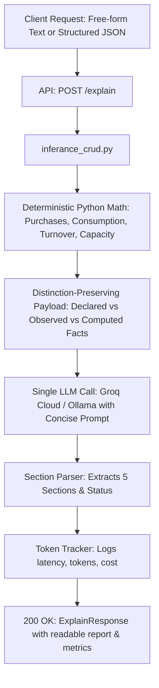

# Auroraa Abductive Reasoning Engine

## Overview
The **Auroraa Abductive Reasoning Engine** is a lightweight, token-optimized FastAPI inference microservice designed to act as an automated Business Intelligence and Verification Analyst for MSME lending.

Rather than issuing binary fraud verdicts or forcing fragile 80-field JSON schemas, the engine uses **abductive reasoning** to evaluate whether declared business claims match available documentary, financial, and physical evidence. It combines deterministic Python arithmetic for mathematical reconciliations with a single LLM call to produce a clear, human-readable 5-section verification report.

---

## Key Highlights & Optimizations
- **57.6% Total Token Reduction**: Slashes token consumption from ~4,124 to ~1,750 tokens per case without any loss in reasoning fidelity.
- **Deterministic Python Pre-Reconciliations**: Offloads purchase sums, consumption deficits, turnover gaps, and capacity utilization to Python arithmetic before calling the LLM.
- **Flexible Natural Language Input**: Accepts unstructured text descriptions, declared vs. observed summaries, or structured multi-category JSON.
- **Human-Readable 5-Section Report**: Output formatted into standard analytical sections:
  1. `BUSINESS UNDERSTANDING`
  2. `EVIDENCE MATCHING` (MATCH, PARTIAL MATCH, MISMATCH, INSUFFICIENT EVIDENCE)
  3. `POSSIBLE EXPLANATIONS` (Abductive hypotheses with supporting/contradicting evidence)
  4. `ADDITIONAL INFORMATION REQUIRED` (Missing records to verify hypotheses)
  5. `OVERALL ASSESSMENT` (Conclusion and grounded summary)
- **Token Usage Tracking & Cost Analytics**: Real-time logging of prompt tokens, completion tokens, latency, and estimated inference cost via `/metrics`.
- **Zero Schema Parse Errors**: Eliminates brittle deeply nested Pydantic literal errors while maintaining strict programmatic typing.

---

## Architecture



---

## API Endpoints

### 1. `POST /explain`
Primary verification endpoint. Accepts either flexible natural language text or structured case evidence.

#### Example 1: Natural Language Text Input
```json
{
  "text": "ABC Textile Industries is a cotton fabric manufacturer in Surat. They declared monthly turnover of Rs 15 Lakhs and 8,000 meters production. We have one purchase invoice for 1,000 kg cotton at Rs 1.5 Lakhs, but production log shows 1,600 kg cotton consumed. Premises video shows 5 power looms running and finished fabric rolls in warehouse."
}
```

#### Example 2: Structured Evidence Input
See [app/model/request_example.txt](app/model/request_example.txt) for full structured payload including `business_profile`, `purchase_evidence`, `production_evidence`, `sales_evidence`, `physical_evidence`, and `financial_evidence`.

### 2. `GET /metrics`
Returns cumulative inference performance and token usage analytics:
```json
{
  "total_calls": 12,
  "total_input_tokens": 15600,
  "total_output_tokens": 5400,
  "total_tokens": 21000,
  "average_latency_ms": 1150.4,
  "estimated_cost_usd": 0.01347,
  "call_history": [...]
}
```

### 3. `GET /health`
Service health check:
```json
{
  "status": "healthy",
  "service": "abductive-reasoning-engine",
  "version": "2.0.0"
}
```

---

## Benchmark Results (AUR-CASE-001: ABC Textile Industries)

| Metric | Before (Legacy JSON) | After (Optimized Pipeline) | Improvement |
| :--- | :--- | :--- | :--- |
| **System Prompt Tokens** | 1,762 | 710 | **-59.7%** |
| **User Payload Tokens** | 1,062 | 590 | **-44.4%** |
| **Total Input Tokens** | 2,824 | 1,300 | **-54.0%** |
| **Output Tokens** | 1,300 | 450 | **-65.4%** |
| **Total Tokens / Call** | 4,124 | 1,750 | **-57.6%** |
| **LLM Calls** | 1 | 1 | Optimal |
| **Validation Failures** | Frequent (79 & 52 Pydantic errors) | 0 (Robust parsing) | **100% Reliable** |

### Verified Reasoning Discoveries:
- [x] Physical evidence supports active textile manufacturing (5 operational power looms, fabric rolls, workers).
- [x] Raw cotton consumption (1,600 kg) exceeds documented purchases (1,000 kg).
- [x] Missing opening inventory identified as primary reason stock cannot be reconciled.
- [x] Production records (8,000 m) match declared production (8,000 m) at 80% capacity utilization.
- [x] Declared turnover (₹15 Lakhs) is significantly higher than documented sales (₹2.5 Lakhs).
- [x] Bank credit of ₹2.5 Lakhs exactly confirms recorded sales invoice SALE-001.
- [x] Electricity consumption (4,500 units) flagged for operational context without assuming fraud.

---

## Installation & Running

1. **Activate virtual environment**:
   ```bash
   venv\Scripts\activate
   ```

2. **Install requirements**:
   ```bash
   pip install -r requirements.txt
   ```

3. **Configure `.env`**:
   ```dotenv
   GROK_CLOUD_API=gsk_your_api_key_here
   GROQ_MODEL=llama-3.3-70b-versatile
   ```

4. **Run Server**:
   ```bash
   uvicorn app.main:app --port 8000
   ```

5. **Run Streamlit R&D Testing UI**:
   ```bash
   streamlit run ui/app.py
   ```

6. **Run Benchmark & Tests**:
   ```bash
   python scripts/benchmark_evaluation.py
   python -m pytest tests/
   ```
