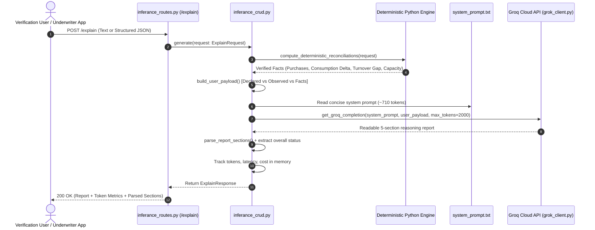

# Auroraa Abductive Reasoning Engine Workflow

This document details the optimized pipeline, deterministic pre-reconciliation logic, distinction-preserving evidence formatting, and 5-section abductive reporting flow.

---

## Processing Pipeline Flow

---

## 1. Input Processing & Distinction Preservation
The pipeline supports both unstructured natural language narrative and multi-category structured evidence without enforcing brittle schemas.

It organizes input into three clear semantic tiers:
1. **Declared Business Claims**: Self-reported numbers (monthly turnover, claimed capacity, declared production, inventory declarations).
2. **Observed Evidence & Records**: Independent verifiable records (supplier bills, bank transactions, GST records, visual video/image findings).
3. **Deterministic Fact Check (Python-Verified Math)**: Pre-computed mathematical reconciliations to eliminate LLM arithmetic errors and save tokens.

---

## 2. Deterministic Arithmetic Engine
Python executes exact calculations before LLM invocation:
* **Material Balance**: Documented purchases vs recorded consumption delta and deficit.
* **Production vs Capacity**: Utilization percentage and declared vs recorded alignment.
* **Turnover Coverage**: Total documented sales invoices vs declared monthly turnover gap.
* **Banking Alignment**: Cross-match of incoming bank credits against invoiced customer receivables.
* **Equipment Verification**: Count and operating condition of physical machinery.

---

## 3. Human-Readable 5-Section Output Structure

The LLM is prompted to return an underwriter-ready text report structured into 5 standard sections:

### Section 1: BUSINESS UNDERSTANDING
Concise overview of business nature, product/service lifecycle, operating model, capacity, and employee footprint.

### Section 2: EVIDENCE MATCHING
Explicit categorization of key business facets with standardized statuses:
* **Purchases & Consumption**: Evaluates material balance against production needs.
* **Production & Capacity**: Evaluates operational volume against equipment capacity.
* **Sales & Turnover**: Reconciles documented sales with declared turnover and GST filings.
* **Banking & Financials**: Compares invoice amounts with bank credits.
* **Physical & Machinery**: Validates visual presence of machinery and operations.
* **Utilities & Operations**: Cross-references electricity usage with production levels.

Status classifications strictly use:
* `MATCH`
* `PARTIAL MATCH`
* `MISMATCH`
* `INSUFFICIENT EVIDENCE`

### Section 3: POSSIBLE EXPLANATIONS (Abductive Hypotheses)
Synthesizes multiple plausible hypotheses for observed discrepancies rather than jumping to fraud conclusions:
* Identifies supporting evidence
* Identifies contradicting evidence
* Specifies missing information
* Outlines plausibility justification

### Section 4: ADDITIONAL INFORMATION REQUIRED
Specifies concrete documents, registers, or physical checks required to resolve uncertainties (e.g., opening stock register, weighbridge slips, daily production logs).

### Section 5: OVERALL ASSESSMENT
Provides a synthesized verdict:
* Overall conclusion (`MATCH`, `PARTIAL MATCH`, `MISMATCH`, or `INSUFFICIENT EVIDENCE`)
* Grounded narrative summary for credit committee or underwriters.

---

## 4. Token & Latency Metrics Monitoring

Every inference execution automatically records:
* `model`: LLM identifier
* `input_tokens`: Provider-reported prompt tokens
* `output_tokens`: Provider-reported completion tokens
* `total_tokens`: Combined tokens consumed
* `latency_ms`: Round-trip execution time in milliseconds
* `inference_calls`: Number of LLM invocations (strictly 1 call)

Access the live metrics endpoint at `GET /metrics`.
