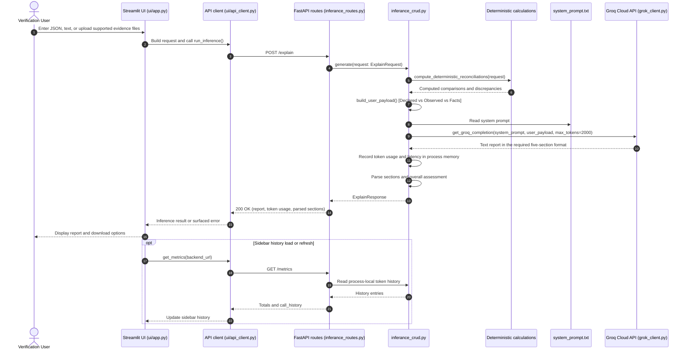

# Auroraa Abductive Reasoning Engine Workflow

This document describes the implemented end-to-end workflow: the Streamlit UI, FastAPI endpoints, evidence preparation, Groq inference, report parsing, and metrics lifecycle. For installation and startup commands, see [setup.md](setup.md).

---

## Processing Pipeline Flow



---

## 1. User Interface and Input Processing

The Streamlit app in `ui/app.py` offers three input modes:

* **JSON input:** Submit an object matching the flexible `ExplainRequest` schema. The app can load a sample case and validate that the JSON is an object before submission.
* **Text input:** Enter business details and declared claims, then add evidence across purchase, inventory, production, sales, physical, financial, and additional-evidence sections. The UI sends these as `declared_information` and `observed_evidence`.
* **File upload:** Extract readable content from JSON, TXT, PDF, and DOCX files. JSON uploads must contain an object. Image and video files are not analyzed or sent as media; the user can provide verified observations as text instead.

The UI sends requests through `ui/api_client.py` to the FastAPI URL configured in the sidebar, `AURORAA_BACKEND_URL`, or `BACKEND_URL` (default `http://localhost:8000`). URL normalization trims whitespace and trailing slashes.

## 2. Evidence Processing & Distinction Preservation
The API accepts a natural-language narrative, declared and observed information, structured business evidence, or a combination. Structured fields are defined in `app/schemas/request_schemas.py`; extra fields are ignored to maintain compatibility.

It organizes input into three clear semantic tiers:
1. **Declared Business Claims**: Self-reported numbers (monthly turnover, claimed capacity, declared production, inventory declarations).
2. **Observed Evidence & Records**: Supplied records and observations (supplier bills, bank transactions, GST records, and user-provided physical observations).
3. **Deterministic Fact Check (Python-Calculated Reconciliations)**: Computed comparisons provide explicit context and reduce reliance on LLM arithmetic.

## 3. Deterministic Reconciliation
Python computes comparisons before the LLM invocation:
* **Material Balance**: Documented purchases vs recorded consumption delta and deficit.
* **Production vs Capacity**: Utilization percentage and declared vs recorded alignment.
* **Turnover Coverage**: Total documented sales invoices vs declared monthly turnover gap.
* **Banking Alignment**: Compare aggregate bank credits with documented sales totals.
* **Physical and Utilities Context**: Record reported machinery counts and electricity consumption.

The computations are added to the user payload as Python-derived facts. They provide reconciliation context; they do not independently verify the source evidence.

## 4. Inference and Response

`POST /explain` validates the request as an `ExplainRequest` and calls `inferance_crud.generate()`. The CRUD layer reads `app/prompt/system_prompt.txt`, builds a distinction-preserving prompt, and calls the Groq chat-completions API through `app/dependencies/grok_client.py`. The model name comes from `GROQ_MODEL`, defaulting to `llama-3.3-70b-versatile`; the key can be provided as `GROQ_API_KEY` or the legacy `GROK_CLOUD_API`. The client retries selected provider errors.

The response follows the five-section report structure:

### Section 1: BUSINESS UNDERSTANDING
Concise overview of business nature, product/service lifecycle, operating model, capacity, and employee footprint.

### Section 2: EVIDENCE MATCHING
Explicit categorization of key business facets with standardized statuses:
* **Purchases & Consumption**: Evaluates material balance against production needs.
* **Production & Capacity**: Evaluates operational volume against equipment capacity.
* **Sales & Turnover**: Reconciles documented sales with declared turnover and GST filings.
* **Banking & Financials**: Compares invoice amounts with bank credits.
* **Physical & Machinery**: Validates visual presence of machinery and operations.
* **Utilities & Operations**: Cross-references electricity usage with production levels.

Evidence status and overall conclusion use:
* `MATCH`
* `PARTIAL MATCH`
* `MISMATCH`
* `INSUFFICIENT EVIDENCE`

### Section 3: POSSIBLE EXPLANATIONS (Abductive Hypotheses)
Synthesizes multiple plausible hypotheses for observed discrepancies rather than jumping to fraud conclusions:
* Identifies supporting evidence
* Identifies contradicting evidence
* Specifies missing information
* Outlines plausibility justification

### Section 4: ADDITIONAL INFORMATION REQUIRED
Specifies concrete documents, registers, or physical checks required to resolve uncertainties (e.g., opening stock register, weighbridge slips, daily production logs).

### Section 5: OVERALL ASSESSMENT
Provides a synthesized verdict:
* Overall conclusion (`MATCH`, `PARTIAL MATCH`, `MISMATCH`, or `INSUFFICIENT EVIDENCE`)
* Grounded narrative summary for credit committee or underwriters.

---

The backend returns the report, parsed sections, overall assessment when recognized, and token metrics in an `ExplainResponse`. Errors from the model provider are surfaced through the API rather than converted to a successful report.

## 5. API Endpoints and Inference History

* **`GET /health`** returns the backend health status.
* **`POST /explain`** accepts evidence and returns an inference report.
* **`GET /metrics`** returns aggregate usage values and `call_history`. Each successful LLM completion adds an entry containing a timestamp, model, input/output/total tokens, latency, and inference-call count. Estimated cost is a rough calculation using fixed per-token rates in the route.
* **`POST /metrics/reset`** clears the backend's token history.

The sidebar loads history when first opened, offers **Refresh history**, and reloads if its backend URL changes. It displays the most recent five entries. History is held in the module-level `_token_history` list in `app/crud/inferance_crud.py`; it is process-local, is cleared when the backend process restarts, and is not shared across multiple workers. The endpoint and sidebar therefore show only the history available in the specific backend process they reach. The UI does not currently provide a reset button.

## 6. Repository Responsibilities

* `ui/app.py`: Streamlit page, input modes, backend selection, and sidebar history.
* `ui/api_client.py`: HTTP calls to `/health`, `/explain`, `/metrics`, and `/metrics/reset`.
* `ui/components.py`: Report rendering and extraction of supported file formats.
* `app/main.py`: FastAPI application and route registration.
* `app/routes/inferance_routes.py`: Health, inference, and metrics endpoints.
* `app/schemas/`: Request and response models.
* `app/crud/inferance_crud.py`: Payload construction, deterministic comparisons, Groq orchestration, report parsing, and in-memory history.
* `app/dependencies/grok_client.py`: Groq HTTP client, retry behavior, and provider usage capture.
* `app/prompt/system_prompt.txt`: Reasoning instructions and report format.
* `tests/`: API/UI and deterministic reasoning tests; `scripts/benchmark_evaluation.py` checks the optimized payload and sample-case calculations.

Run the app using the instructions in [setup.md](setup.md). From the repository root, run tests with:

```powershell
python -m pytest tests/
```
