# Fraud Explanation Engine Workflow

This document details the architectural flow, component relationships, and data processing pipeline of Auroraa's Fraud Explanation Engine.

## Architectural Overview

The engine converts document-authenticity evidence (such as SHAP features, metadata validation errors, and identity values) into structured, plain-language case notes for loan underwriters.

```mermaid
graph TD
    A[API Request /explain] --> B[Pydantic Validation: ExplainRequest]
    B --> C[inferance_crud.py Orchestrator]
    C --> D[registry_service.py: Resolve positive SHAP features]
    D --> E[Filter Payload: Keep only positive features]
    C --> F[Format prompt: Merge system_prompt.txt & inputs]
    F --> G[Groq LLM Completion API]
    G --> H[Parse LLM Response to ExplanationResponse]
    H --> I[API JSON Response]
```



---

## Processing Pipeline Steps

### 1. Request Input & Validation
The API endpoint (`/explain`) receives a JSON payload. Pydantic validates it against the `ExplainRequest` schema in [request_schemas.py](app/schemas/request_schemas.py):
* **SHAP Features:** Features and their mathematical contributions.
* **Features:** Full set of document features.
* **Context:** Mismatch reasons for flagged checks.
* **Individual Data:** Extracted identity metadata (e.g. employee name, PAN number, company name).

### 2. Registry Resolution & Payload Filtering
In [inferance_crud.py](app/crud/inferance_crud.py):
1. **SHAP Filtering:** Only features with `contribution > 0.0` (positive contributors to fraud/forgery score) are parsed.
2. **Registry Mapping:** The positive features are resolved against `SALARY_SLIP_FEATURE_REGISTRY` in [salary_slips_registry.py](app/registry/salary_slips_registry.py) to fetch:
   - Standardized titles (e.g., `PAN Details` instead of `pan_format`).
   - Risk severity (`HIGH`, `MEDIUM`, `LOW`).
   - Action recommendations.
3. **Payload Optimization:** Unflagged features and unused context reasons are stripped to minimize LLM token usage and inference cost.

### 3. Prompt Synthesis
The user message is built by serializing the filtered outputs:
```python
user_message = (
    f"Document Type: {request.document_type}\n"
    f"Verdict: {request.verdict}\n"
    f"Forgery Score: {request.forgery_score}\n\n"
    f"SHAP Features:\n{json.dumps(shap_list, indent=2)}\n\n"
    f"Features:\n{json.dumps(filtered_features, indent=2)}\n\n"
    f"Context:\n{json.dumps(context_list, indent=2)}\n\n"
    f"Individual Data:\n{json.dumps(individual_list, indent=2)}"
    f"{registry_block}"
)
```

### 4. LLM Generation & Mapping Rule
The Groq LLM evaluates the system instructions from [system_prompt.txt](app/prompt/system_prompt.txt) using the structured payload:
* **Registry Information:** Preserves severity, titles, and recommendations exactly.
* **Context Reason:** Explains the math/logic of the failure (e.g., *"₹22,600 mismatch"*).
* **Individual Data:** Forces the LLM to embed names and IDs (e.g., *"BNAPP2390H for Hamza Ali Mazari"*) to ground the finding explanation.

### 5. Final Output
The LLM returns a structured JSON matching `ExplanationResponse` in [response_schemas.py](app/schemas/response_schemas.py):
```json
{
  "findings": [
    {
      "severity": "HIGH",
      "title": "PAN Details",
      "summary": "PAN format check failed",
      "explanation": "The PAN BNAPP2390H for Hamza Ali Mazari check failed because it does not match the expected alphanumeric format or entity code.",
      "recommendation": "Verify the PAN details against the submitted identity record."
    }
  ]
}
```
